<!-- Generated by scripts/build.mjs. Edit the content block there, not this file. -->

<picture><source media="(prefers-color-scheme: dark)" srcset="assets/dark/header.svg"></picture>

[`portfolio`](https://portfolio-site-trism2.vercel.app) · [`linkedin`](https://www.linkedin.com/in/tristan-morton) · [`discord`](https://discord.com/users/543220135260061720)

<picture><source media="(prefers-color-scheme: dark)" srcset="assets/dark/s01.svg"></picture>

<picture><source media="(prefers-color-scheme: dark)" srcset="assets/dark/whoami.svg"></picture>

<picture><source media="(prefers-color-scheme: dark)" srcset="assets/dark/s02.svg"></picture>

<picture><source media="(prefers-color-scheme: dark)" srcset="assets/dark/now.svg"></picture>

<picture><source media="(prefers-color-scheme: dark)" srcset="assets/dark/s03.svg"></picture>

<a href="https://github.com/trism-dev/tripwire-awareness-dashboard"><picture><source media="(prefers-color-scheme: dark)" srcset="assets/dark/p-tripwire.svg"></picture></a>
<a href="https://github.com/trism-dev/heart-disease-prediction"><picture><source media="(prefers-color-scheme: dark)" srcset="assets/dark/p-heart.svg"></picture></a>
<a href="https://github.com/trism-dev/portfolio-site"><picture><source media="(prefers-color-scheme: dark)" srcset="assets/dark/p-portfolio.svg"></picture></a>

<picture><source media="(prefers-color-scheme: dark)" srcset="assets/dark/s04.svg"></picture>

<picture><source media="(prefers-color-scheme: dark)" srcset="assets/dark/stack.svg"></picture>

<!-- telemetry section: add once the metrics workflow has produced assets (see .github/workflows/metrics.yml) -->

<picture><source media="(prefers-color-scheme: dark)" srcset="assets/dark/footer.svg"></picture>
